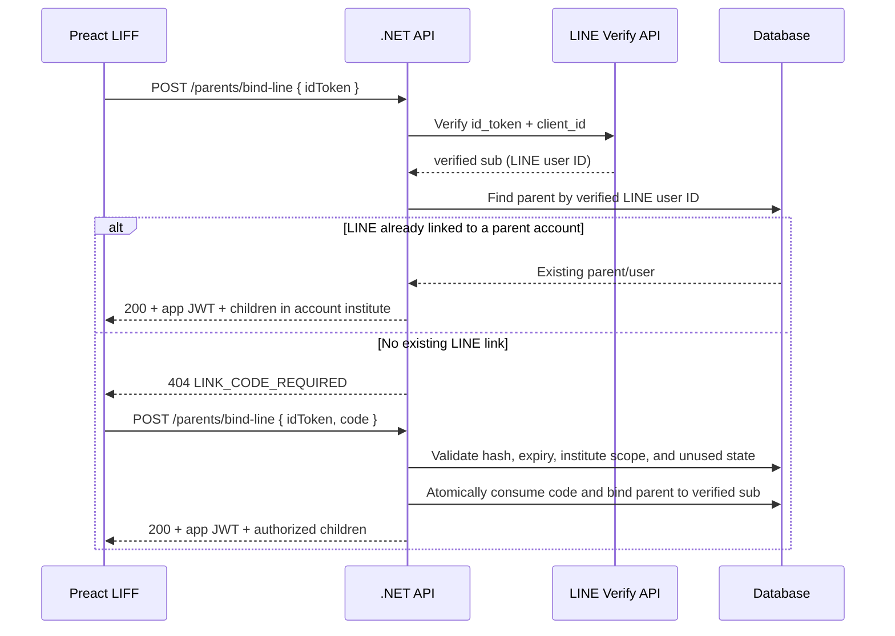

# LINE LIFF Parent Authentication and Binding

สถานะเอกสาร: อธิบายพฤติกรรมที่ implement อยู่ในปัจจุบัน และข้อกำหนดด้านความปลอดภัยที่ต้องรักษาเมื่อแก้ flow นี้

## สรุปสั้น

- LIFF ส่ง **LINE ID Token** (`idToken`) ให้ API ไม่ส่ง LINE profile หรือ `lineUserId` ที่ client อ้างเอง
- API ตรวจ ID Token กับ LINE Verify API โดยใช้ `Line:LoginChannelId` แล้วใช้ `sub` ที่ LINE ยืนยันเป็น LINE user ID
- ถ้า LINE ID นี้ผูกกับบัญชีผู้ปกครองแล้ว API ออก JWT ของระบบให้
- การค้นด้วยเบอร์อย่างเดียวไม่ใช่หลักฐานว่าเป็นเจ้าของบัญชี: API ไม่ผูกบัญชีด้วยเบอร์ล้วน
- First-time parent linking uses a school-issued one-time code, scoped to one parent-child relationship and institute, expiring after 5 days.
- `MODE_TEST_AUTH=true` is a LIFF client-side diagnostic display only; the API has no test-auth bypass.
- ถ้าเบอร์ซ้ำหรือพบ LINE binding ที่ขัดแย้งกัน ให้ปฏิเสธการผูก ห้ามเลือกแถวแรกแบบเงียบ ๆ

## Flow ปัจจุบัน

### 1. LIFF client

- `LineLiff/src/services/liff.js` obtains the token with `liff.getIDToken()`.
- `LineLiff/src/pages/login.jsx` posts `{ idToken, code }` to `POST /parents/bind-line` for first-time binding.
- The client must not send a profile-supplied LINE user ID as proof of identity.
- The app JWT is stored as `parent_token`; it is separate from the LINE ID Token.

### 2. API verification and lookup

- `API/Controllers/ParentEndpoints.cs` posts `id_token` and the configured `client_id` to LINE's ID Token Verify API.
- Only the verified `sub` is passed to the parent service.
- `API/Services/ParentService.cs` first looks up records associated with that LINE user ID.
- A previously linked LINE ID must resolve consistently to one parent account. Conflicting account IDs, missing users, or different existing LINE IDs fail closed.
- Phone-based matching has been removed from the LINE binding flow.
- First-time binding requires a school-issued one-time code. The raw code is shown once when issued; only a SHA-256 hash is stored. It expires after five days and is single-use.
- After successful existing-link authentication, returned children are scoped to the selected account's institute. This does not yet implement a general multi-institute institute-switching flow.

### 3. API response behavior

| Situation | HTTP | Code/behavior |
|---|---:|---|
| Verified LINE already linked to a consistent parent account | 200 | Returns app JWT, parent summary, and children |
| No existing LINE binding and no code supplied | 404 | `LINK_CODE_REQUIRED`; client displays the school-issued code form |
| Invalid, expired, or already used/revoked code | 400 / 409 | Specific code error; no binding write or app JWT |
| Conflicting LINE/account mapping | 409 | `PARENT_BINDING_REQUIRES_REVIEW`; no binding write, no app JWT |
| Missing ID token / invalid ID token | 400 / 401 | Authentication denied |

The server verifies both LINE identity and the one-time code; frontend profile fields are display-only.

## `MODE_TEST_AUTH` local diagnostics

This flag only exposes client-side LINE profile diagnostics and a test hint. It does **not** relax authentication or bypass the school-issued-code requirement. Phone-based test binding has been removed.

### Required database and API setup

- Create and apply `API/Database/2026-10-18-parent-line-link-codes.sql` before deploying the API or issuing linking codes.
- The staff UI issues the code from the target student's profile; API access is restricted to authenticated `admin` or `staff` claims in the active institute.
- Codes use 60 bits of random entropy, are stored only as hashes, and are consumed atomically once. Add request rate limiting only after configuring trusted client-IP forwarding through the Vercel/Nginx proxy chain; a naive remote-IP limiter may throttle all users behind the same proxy.
- `MODE_TEST_AUTH=true` in Vite may be used to inspect profile data locally; it is never an API authorization setting.

### LIFF-side display flag (not a security control)

- `LineLiff/.env` can set `MODE_TEST_AUTH=true` to show the test-mode hint and raw LINE profile payload in the login screen.
- `LineLiff/vite.config.js` exposes this variable to Vite via `envPrefix`.
- Restart Vite after changing `.env`; Vite reads env files at startup/build.
- `.env` is local to the developer machine. For a temporary Vercel Preview, set `MODE_TEST_AUTH=true` in that Vercel project's Preview build environment and redeploy; local `.env` does not affect the hosted app.
- The frontend flag only controls a debug display. It is informational only and never controls API authorization. Do not leave profile debugging enabled on a public Production deployment because the profile payload contains personal data.

### Safe test procedure

1. Apply the linking-code SQL to the intended database and deploy the API.
2. From an authorized admin/staff account, open the correct student's profile and issue a code for the intended parent row.
3. Deliver the code privately to that parent. The code is bearer material; anyone possessing it can redeem it until expiry/revocation.
4. In LIFF, use a LINE account whose ID Token verifies against the configured Login channel, then enter the code.
5. Confirm the intended parent row and only authorized child/institute data are returned.
6. Retry the code; confirm reuse is rejected. Test expired/revoked/invalid code and a LINE ID already linked to another institute; confirm no unintended write occurs.

> Warning: treat the issued code like a password until redeemed. Deliver it only to the verified parent, do not put raw codes in logs, and do not leave codes exposed in screenshots or chat.

## Data model and multi-child/multi-institute limits

- Multiple `Parent` rows can be associated to one `UserId`; these rows represent parent-child relationships.
- Same-account sibling rows may be returned together where they are associated to the same user and selected institute.
- A phone number is not a stable guardian identifier: it can be shared, duplicated across students/institutes, changed, or recycled.
- The current token contains one `institute_id`; it is not a complete multi-institute authorization design. Do not broaden global tenant filters or return all institutes' children without explicit per-request authorization.
- Linking a parent account across multiple institutes is not implemented. Each code is limited to its issuing institute; do not treat the current single-institute token as multi-institute authorization.

## Security invariants / regression checks

Keep these true when changing the flow:

- Trust LINE `sub` only after server-side verification for the expected channel ID.
- Never overwrite a different existing `Parent.LineUserId` or `User.LineUserId`.
- Invalid/expired/used/revoked/conflicting code attempts must not mutate a binding or return an app JWT.
- First-time binding requires an unexpired, unused, non-revoked code scoped to the intended parent and institute.
- Store only a one-way hash of a high-entropy code; show the raw code only once at issuance.
- Consume the code and save the LINE binding atomically; a code must not succeed twice, including concurrent attempts.
- Keep institute isolation when returning parent/child data.

## Troubleshooting API 502 during local LIFF testing

- The public VPS API base is `http://165.101.65.84/api` on **port 80** (HTTP; omitted ports default to 80). Nginx receives public traffic on port 80 and proxies internally to the .NET service at `localhost:5000`. Port 5000 is an internal upstream port; clients should not need to connect to it directly.
- Local LineLiff uses `VITE_API_URL=/api`; the Vite dev server proxies `/api/*` to `http://165.101.65.84` so the browser does not make a cross-origin HTTP request. Restart Vite after editing `.env` or `vite.config.js`.
- Production LineLiff uses same-origin `/api` and the `LineLiff/vercel.json` rewrite to the VPS. The VPS health endpoint has been confirmed to return Healthy. If health is healthy but `/api/parents/bind-line` returns 502, inspect Vercel function/proxy logs and API/Nginx logs at the request timestamp. Do not infer that LINE token verification failed from a 502; invalid LINE tokens should return 401.
- A `VITE_API_URL` change is compiled into the Vite build. Redeploy/rebuild production after changing Vercel environment variables.

> The Vite development proxy target is the shared VPS. It uses the configured remote API/database, so do not run write tests against real accounts or production records. For isolated linking-code tests, use a local API plus a non-production database and change the proxy target intentionally.

Binding regression coverage lives in `API/academy-API.Tests/unitTest/ParentServiceTests.cs` and `API/academy-API.Tests/integration/ParentLineLinkServiceTests.cs`. The link-code integration tests cover hashed storage, single-use redemption, institute scoping, invalid/expired codes, and cross-institute LINE-account conflicts. Run the backend test project after changing binding behavior. LIFF tests/build live under `LineLiff`.

## Source of truth

- Endpoint + LINE token verification: `API/Controllers/ParentEndpoints.cs`
- Binding decisions and status results: `API/Services/ParentService.cs`, `API/Services/Contracts/ParentServiceResults.cs`
- Candidate lookup and institute-specific children: `API/Repositories/ParentRepository.cs`
- LIFF login and display hint: `LineLiff/src/pages/login.jsx`, `LineLiff/vite.config.js`, `LineLiff/.env`
- API contract summary: `Objective/specAPI.md`, section 13, Parents / LINE LIFF
